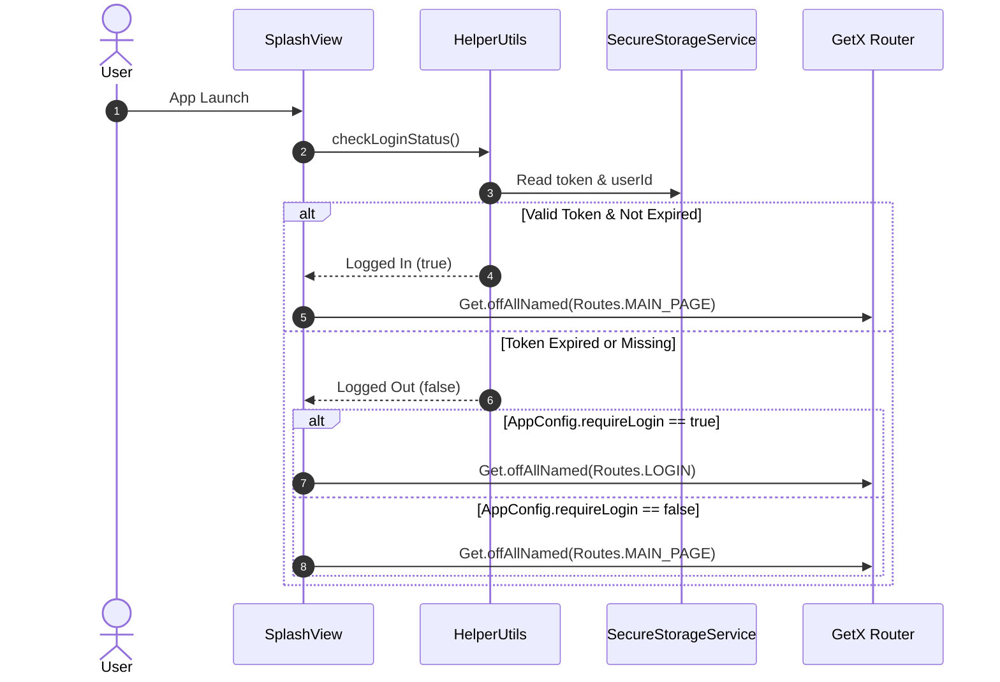

# Flutter Boilerplate with GetX CLI

<p align="center">
  
</p>

<p align="center">
  <b>A production-ready, scalable, and modular Flutter architecture powered by GetX CLI, Repository Pattern, Dio networking, dual-layer storage, responsive typography, and a rich library of reusable UI widgets.</b>
</p>

<p align="center">
  
  
  
  
  
  
</p>

---

## 📋 Table of Contents

- [Overview](#-overview)
- [Architecture & Design Pattern](#-architecture--design-pattern)
- [Key Features](#-key-features)
  - [1. Authentication & Session Lifecycle](#1-authentication--session-lifecycle)
  - [2. Enterprise Networking Layer](#2-enterprise-networking-layer)
  - [3. Dual-Tier Storage Architecture](#3-dual-tier-storage-architecture)
  - [4. State Management & Data Fetching Mixins](#4-state-management--data-fetching-mixins)
  - [5. Design System, Responsive UI & Theming](#5-design-system-responsive-ui--theming)
  - [6. Reusable Global UI Components](#6-reusable-global-ui-components)
  - [7. Asset & Code Generation](#7-asset--code-generation)
- [Directory Structure](#-directory-structure)
- [Getting Started](#-getting-started)
  - [Prerequisites](#prerequisites)
  - [Installation & Setup](#installation--setup)
- [GetX CLI Cheatsheet](#-getx-cli-cheatsheet)
- [Configuration & Customization](#-configuration--customization)
- [Developer Recipes (How-To Guides)](#-developer-recipes-how-to-guides)
  - [Adding a New API & Repository](#recipe-1-adding-a-new-api--repository)
  - [Creating a Paginated Grid Screen](#recipe-2-creating-a-paginated-grid-screen)
  - [Protecting Actions for Guest Users](#recipe-3-protecting-actions-for-guest-users)
  - [Adding Type-Safe Assets](#recipe-4-adding-type-safe-assets)
- [Dependencies Overview](#-dependencies-overview)
- [Author & Credits](#-author--credits)

---

## 🌟 Overview

**Flutter Boilerplate with GetX CLI** is an enterprise-grade starter template designed to accelerate mobile app development without compromising on maintainability, scalability, or clean code principles.

Instead of reinventing authentication, network error handling, session token refresh, responsive layouts, or pagination for every new app, this boilerplate provides standard solutions pre-integrated and ready for production.

---

## 🏛 Architecture & Design Pattern

The application is structured according to the **GetX CLI Clean Architecture** guidelines and enforces the **Repository Pattern**:

```mermaid
flowchart TD
    subgraph UI ["Presentation Layer (lib/app/modules)"]
        View["View (GetView)"]
        Controller["Controller (GetxController)"]
        Binding["Binding (Bindings)"]
    end

    subgraph Data ["Data Layer (lib/app/data)"]
        RepoInterface["Repository Interface (e.g., IProductRepository)"]
        RepoImpl["Repository Implementation (ProductRepository)"]
        Models["Data Models (fromJson / toJson)"]
    end

    subgraph Core ["Core Infrastructure (lib/app/core)"]
        ApiClient["ApiClient (Dio Client)"]
        AuthInterceptor["AuthInterceptor"]
        SecureStore["SecureStorageService (Encrypted Tokens)"]
        HiveStore["HiveService (Fast NoSQL Cache)"]
    end

    View -->|User Action / Obx State| Controller
    Binding -->|Injects| Controller
    Controller -->|Calls API Method| RepoInterface
    RepoInterface <|.. RepoImpl
    RepoImpl -->|Network Request| ApiClient
    ApiClient -->|Injects Bearer Token / Handles 401| AuthInterceptor
    AuthInterceptor -->|Reads / Clears Session| SecureStore
    RepoImpl -->|Parses JSON| Models
```

### High-Level Architectural Highlights:
1. **Separation of Concerns**: Views observe controllers via `Obx` or `GetView`; controllers interact with abstract repositories; repositories manage `ApiClient` interactions; and models parse raw responses into strongly-typed Dart objects.
2. **Dependency Injection**: Root-level dependencies (`ApiClient`, `IAuthRepository`, `IProductRepository`) are injected during application bootstrap in `AppRepositoryBinding` using lazy loading (`fenix: true`), ensuring memory efficiency and auto-recreation when accessed.
3. **Strict Route Segregation**: Centralized route definitions in `app_routes.dart` and route bindings in `app_pages.dart`.

---

## ✨ Key Features

### 1. Authentication & Session Lifecycle
- **Dual Session Mode (Remember Me)**:
  - When *Remember Me* is enabled: credentials and JWT tokens persist to `FlutterSecureStorage`.
  - When *Remember Me* is disabled: session lives strictly in memory, ensuring that killing the app requires re-authentication on the next launch.
- **Client-Side JWT Expiration Check**: The `HelperUtils.isTokenExpired()` decodes the `exp` claim from JWT tokens on app boot. If expired, it proactively clears stored data without unnecessary network roundtrips.
- **Automated 401 & Session Expiration**: `AuthInterceptor` intercepts HTTP 401s on protected endpoints and triggers `HelperUtils.handleSessionExpired()`, displaying an interactive warning dialog that securely wipes the local session and redirects the user to the login screen.
- **Configurable Guest Access**: Toggle `AppConfig.requireLogin`:
  - `true`: Guests are forced to the Login screen directly from Splash.
  - `false`: Guests can browse the `MainPage`; sensitive operations can be gated with `showAuthDialog()`.



### 2. Enterprise Networking Layer
- **Dio HTTP Client**: Configured with 30s connection/receive timeouts in `ApiClient`.
- **Dynamic Authorization Header**: Bearer token dynamically injected on every request via `AuthInterceptor`.
- **Intelligent Exception Mapping (`ApiException`)**: Automatically handles:
  - Connection timeouts, Receive timeouts, Send timeouts
  - Network disconnection / SocketExceptions
  - Request cancellations
  - Structured field-level validation messages from API responses
- **Centralized UI Feedback (`handleException`)**: Single handler that logs debug info with `Logger` and displays formatted, contextual snackbars to the user.

### 3. Dual-Tier Storage Architecture
- **`FlutterSecureStorage` (Encrypted)**: Used exclusively for sensitive security tokens, user IDs, and auth roles (`SecureStorageService`).
- **`Hive` (High-Speed Local Cache)**: Key-value NoSQL database initialized in `HiveService` for caching search history, user preferences, onboarding flags, language settings, and generic app data.

### 4. State Management & Data Fetching Mixins
Two pre-built mixins simplify controller state management:

- **`SimpleFetchMixin`**: Standardizes non-paginated API fetches with an observable `isFetching` state and an `onFetchError` callback hook.
- **`PaginatedFetchMixin`**: Standardizes infinite scroll / pagination:
  - Manages `isFetching` (initial load), `isLoadingMore` (subsequent pages), `isEndPage`, and page counter.
  - Automatically attaches scroll listeners to detect bottom scroll thresholds.
  - Includes pull-to-refresh logic and error handlers.

### 5. Design System, Responsive UI & Theming
- **`flutter_screenutil`**: Scalable sizing configured for `Size(360, 690)`.
- **Extensions**:
  - **Sizing**: `16.height`, `20.width` replaces verbose `SizedBox(height: 16.h)`.
  - **Typography**: Quick context-based text styles: `context.headlineLarge`, `context.titleLarge`, `context.bodyMedium`, `context.labelSmall`.
  - **Currency**: `price.getCurrency(isDecimal: true)` formats numerical amounts with dynamic currency symbols (e.g., `$19.99`).
- **Theming (`AppTheme`)**: Complete light and dark themes using Google Fonts (Poppins), custom Material 3 `ColorScheme`, and customized `AppBarTheme`.

### 6. Reusable Global UI Components

| Component | Description |
|---|---|
| `PaginatedGridView` | High-performance grid supporting **Masonry** (`flutter_staggered_grid_view`) and **Uniform** grids with pull-to-refresh, load-more indicators, and empty states. |
| `SimpleGridView` | Grid view component for non-paginated API listings with built-in pull-to-refresh and empty states. |
| `AppInputTextFormField` | Fully customizable form input with custom borders, floating labels, hint texts, validation, and `PasswordInputField` with toggleable visibility. |
| `CustomAppBar` | Versatile AppBar supporting 9+ configurations: custom actions, badge counters, back buttons, subtitles, and bottom widgets. |
| `GlobalButton` | Multi-style button supporting gradients, solid colors, borders, custom icons, loading indicators, and disabled states. |
| `CachedImage` | Network image loader wrapping `cached_network_image` and `flutter_svg`, with shimmer placeholders and desktop browser headers to prevent CDN 403 errors. |
| `DialogUtils` | Modal dialogs powered by `AwesomeDialog` (info, warning, question, error, exit confirmation). |
| `CustomDialog` | Dialog layout featuring an SVG header icon, headline, subtitle, and dynamic action buttons. |
| `ShowEmptyResult` | Empty state placeholder with an image, title, optional subtitle, and retry button. |
| `GlobalLoading` | Standardized brand loader using `LoadingAnimationWidget.threeArchedCircle`. |
| `ShimmerLoading` | Shimmer skeleton blocks (`ShimmerBox`) for loading states. |
| `GlobalSnackbar` & `GlobalToast` | Quick, styled popup notifications. |
| `ViewRatingStars` | Dynamic star rating visualization using `flutter_rating_bar`. |
| `CountdownTimerWidget` | Real-time countdown timer for flash deals or token expiries. |
| `BadgeIcon` | Icon overlay badge with animated counter via `badges`. |
| `ImagePickerHelper` | Helper methods for single and multi-image selection from gallery or camera. |

### 7. Asset & Code Generation
- **`lib/gen/assets.gen.dart`**: Generated type-safe asset constants (`Assets.icons.*`, `Assets.images.*`, `Assets.logos.*`).
- **`flutter_launcher_icons`**: Ready-to-generate native Android and iOS launcher icons.

---

## 📁 Directory Structure

```text
lib/
├── app/
│   ├── core/                       # Core system functionality & configurations
│   │   ├── config/
│   │   │   └── app_config.dart     # Global configuration (URLs, app name, flags)
│   │   ├── constants/
│   │   │   └── enums.dart          # App-wide enums and status constants
│   │   ├── extensions/
│   │   │   ├── get_currency_extension.dart # Number to formatted currency extension
│   │   │   ├── sizedbox_extension.dart     # num.height and num.width extensions
│   │   │   └── text_style_extension.dart   # BuildContext textTheme extensions
│   │   ├── network/
│   │   │   ├── api_client.dart     # Base Dio wrapper with handleRequest<T>()
│   │   │   ├── api_endpoints.dart  # Centralized API URLs & routes
│   │   │   ├── api_exception.dart  # Custom Dio exception parser
│   │   │   ├── auth_interceptor.dart # Injects Bearer token, intercepts 401s
│   │   │   └── handle_exceptions.dart# Central UI exception handler with Logger
│   │   ├── services/
│   │   │   ├── local_store_service.dart   # Hive local storage & search history
│   │   │   └── secure_storage_service.dart# FlutterSecureStorage for auth credentials
│   │   ├── theme/
│   │   │   ├── app_color.dart      # Color palette (Light, Dark, Semantic)
│   │   │   └── app_theme.dart      # Light & Dark ThemeData configurations
│   │   └── utils/
│   │       ├── dialog_utils.dart   # AwesomeDialog wrapper
│   │       ├── helper_utils.dart   # Session, token validation, logout, navigation
│   │       ├── image_picker_helper.dart # Single & multiple image picker
│   │       ├── logger.dart         # Logger wrapper (Log.d, Log.i, Log.e, Log.w)
│   │       └── url_launcher.dart   # Safe external URL launcher
│   │
│   ├── data/                       # Data layer (repositories and models)
│   │   ├── models/
│   │   │   ├── auth_models/        # LoginModel, LoginData
│   │   │   ├── user_models/        # UserModel, UserData
│   │   │   └── products_model.dart # Products catalog model
│   │   └── repositories/
│   │       ├── app_repository_binding.dart # Root binding registering repositories
│   │       ├── auth_repository.dart       # IAuthRepository & AuthRepository
│   │       └── product_repository.dart    # IProductRepository & ProductRepository
│   │
│   ├── global/                     # Shared widgets, components, and layouts
│   │   ├── layouts/
│   │   │   └── product_layout.dart # Reusable product card layout
│   │   └── widgets/
│   │       ├── app_input_text_form_field.dart # Custom inputs & Password field
│   │       ├── app_svg_icon.dart
│   │       ├── app_text.dart               # Auto-translated localized text
│   │       ├── appbar_title.dart
│   │       ├── badge_icon.dart
│   │       ├── cached_image.dart           # Cached raster and SVG image viewer
│   │       ├── countdown_timer_widget.dart
│   │       ├── custom_appbar.dart          # Highly configurable AppBar
│   │       ├── custom_check_box.dart
│   │       ├── custom_dialog.dart
│   │       ├── custom_icon_button.dart
│   │       ├── fetch_mixins.dart           # SimpleFetchMixin & PaginatedFetchMixin
│   │       ├── format_time.dart            # Date and time formatting utils
│   │       ├── get_image_url.dart          # Image URL resolving helper
│   │       ├── global_button.dart          # Unified app button
│   │       ├── global_loading.dart         # Standard loader
│   │       ├── global_snackbar.dart
│   │       ├── global_tost.dart
│   │       ├── paginated_views.dart        # PaginatedGridView (Masonry & Uniform)
│   │       ├── shimmer_loading.dart        # ShimmerBox skeletons
│   │       ├── show_auth_dialog.dart       # Guest login prompt dialog
│   │       ├── show_empty_result.dart      # Empty state fallback widget
│   │       ├── simple_views.dart           # SimpleGridView for non-paginated lists
│   │       └── view_rating_stars.dart
│   │
│   ├── modules/                    # Feature modules (GetX CLI architecture)
│   │   ├── home/                   # Home screen module (bindings, controller, view)
│   │   ├── login/                  # Authentication module
│   │   ├── main_page/              # Bottom navigation holder & back-press handling
│   │   ├── products/               # Infinite-scroll / paginated products showcase
│   │   ├── profile/                # Profile / simple products showcase
│   │   └── splash/                 # Splash screen with animated entrance
│   │
│   └── routes/                     # Centralized navigation routing
│       ├── app_pages.dart          # GetPage routes configuration
│       └── app_routes.dart         # Route string paths
│
├── gen/                            # Generated assets constants
│   └── assets.gen.dart
│
└── main.dart                       # App entry point (ScreenUtil & Theme initialization)
```

---

## 🚀 Getting Started

### Prerequisites
- **Flutter SDK**: `^3.11.4` or higher
- **Dart SDK**: `^3.0.0`
- **GetX CLI** (Optional, recommended):
  ```bash
  dart pub global activate get_cli
  ```

### Installation & Setup

1. **Clone the repository**:
   ```bash
   git clone https://github.com/mosharof5khan/Flutter-Boilerplate-With-GetX-CLI.git
   cd Flutter-Boilerplate-With-GetX-CLI
   ```

2. **Install project dependencies**:
   ```bash
   flutter pub get
   ```

3. **Generate Assets (if new files are placed in `assets/`)**:
   ```bash
   dart run build_runner build --delete-conflicting-outputs
   ```

4. **Generate App Launcher Icons (optional)**:
   ```bash
   dart run flutter_launcher_icons
   ```

5. **Run the application**:
   ```bash
   flutter run
   ```

---

## 🛠 GetX CLI Cheatsheet

This project is tailored to work directly with the official [GetX CLI](https://pub.dev/packages/get_cli). You can generate modules, pages, controllers, and bindings instantly:

```bash
# Generate a new module (view, controller, binding, and route entry)
get create page:order

# Generate a controller for a specific module
get create controller:cart on modules/cart

# Generate a view
get create view:cart_details on modules/cart

# Generate a model from a JSON file or API
get generate model on data with assets/models/sample.json
```

---

## ⚙️ Configuration & Customization

### 1. App Configuration (`lib/app/core/config/app_config.dart`)
```dart
class AppConfig {
  static String appName = "Quick Cart";
  static const domainUrl = "https://your-api-domain.com";
  
  /// Set to true: Users must log in before accessing MainPage.
  /// Set to false: Guests can browse the MainPage immediately.
  static const bool requireLogin = false;
  
  static String appLogo = "assets/logos/app_icon.png";
  static String splashLogo = "assets/logos/app_icon.png";
}
```

### 2. API Endpoints (`lib/app/core/network/api_endpoints.dart`)
Manage all API paths in one centralized class:
```dart
class ApiEndpoint {
  static const String domainUrl = AppConfig.domainUrl;
  static const String baseUrl = '$domainUrl/api';

  static const String login = '$baseUrl/auth/login';
  static const String me = '$baseUrl/auth/me';
  static const String productList = 'https://dummyjson.com/products';
}
```

### 3. Theme & Colors (`lib/app/core/theme/`)
Modify `app_color.dart` to match your brand:
```dart
class AppColor {
  static const Color primary = Color(0xFF0052CC);
  static const Color secondary = Color(0xFF58619C);
  static const Color error = Color(0xFFDF1C41);
  // ...
}
```

---

## 💡 Developer Recipes (How-To Guides)

### Recipe 1: Adding a New API & Repository

1. **Define the interface and implementation in `lib/app/data/repositories/order_repository.dart`**:
   ```dart
   abstract class IOrderRepository {
     Future<List<OrderModel>> getOrders();
   }

   class OrderRepository implements IOrderRepository {
     final ApiClient _client;
     OrderRepository(this._client);

     @override
     Future<List<OrderModel>> getOrders() {
       return _client.handleRequest(
         () => _client.dio.get(ApiEndpoint.orders),
         (dynamic data) => (data as List).map((x) => OrderModel.fromJson(x)).toList(),
         'Get Orders',
       );
     }
   }
   ```

2. **Register in `AppRepositoryBinding` (`lib/app/data/repositories/app_repository_binding.dart`)**:
   ```dart
   Get.lazyPut<IOrderRepository>(
     () => OrderRepository(Get.find<ApiClient>()),
     fenix: true,
   );
   ```

---

### Recipe 2: Creating a Paginated Grid Screen

1. **Controller (`order_controller.dart`)**:
   ```dart
   class OrderController extends GetxController with PaginatedFetchMixin {
     final IOrderRepository _repo = Get.find<IOrderRepository>();
     final orderList = <OrderModel>[].obs;

     @override
     Future<void> fetchPage(int page) async {
       final items = await _repo.getOrders(limit: pagination, skip: page * pagination);
       if (page == pageBase) {
         orderList.value = items;
       } else {
         orderList.addAll(items);
       }
       if (items.length < pagination) isEndPage = true;
     }

     @override
     void onFetchError(dynamic e) => handleException(e, context: 'Orders');
   }
   ```

2. **View (`order_view.dart`)**:
   ```dart
   class OrderView extends GetView<OrderController> {
     const OrderView({super.key});

     @override
     Widget build(BuildContext context) {
       return Scaffold(
         appBar: CustomAppBar(title: "Orders"),
         body: Obx(
           () => PaginatedGridView(
             scrollController: controller.scrollController,
             itemCount: controller.orderList.length,
             isFetching: controller.isFetching.value,
             isLoadingMore: controller.isLoadingMore.value,
             isEmpty: controller.orderList.isEmpty,
             onRefresh: () => controller.fetchData(),
             gridType: PaginatedGridType.masonry,
             itemBuilder: (context, index) => OrderCard(order: controller.orderList[index]),
           ),
         ),
       );
     }
   }
   ```

---

### Recipe 3: Protecting Actions for Guest Users

When `AppConfig.requireLogin` is set to `false`, guest users can browse public screens. Guard protected actions (like checkout, profile editing, or wishlisting):

```dart
void onAddToCart() {
  if (!HelperUtils.isLogin) {
    showAuthDialog(); // Displays modal: "You are Unauthenticated! Please Login / Signup"
    return;
  }
  // Proceed with protected cart logic
}
```

---

### Recipe 4: Adding Type-Safe Assets

1. Drop your SVGs or images into the corresponding directory:
   - `assets/icons/`
   - `assets/images/`
   - `assets/logos/`
2. Access the assets anywhere with zero typos via `Assets`:
   ```dart
   // SVGs:
   customSvgImage(imagePath: Assets.icons.homeIcon)

   // Raster images:
   Image.asset(Assets.images.emptyBox.path)
   ```

---

## 📦 Dependencies Overview

| Package | Purpose |
|---|---|
| [`get`](https://pub.dev/packages/get) | High-performance state management, navigation, and dependency injection |
| [`dio`](https://pub.dev/packages/dio) | Powerful HTTP networking client with interceptors |
| [`flutter_secure_storage`](https://pub.dev/packages/flutter_secure_storage) | Keychain & KeyStore encrypted storage for JWT tokens and auth credentials |
| [`hive`](https://pub.dev/packages/hive) | Lightweight and blazing fast key-value database |
| [`flutter_screenutil`](https://pub.dev/packages/flutter_screenutil) | Responsive layout adaptation across all screen resolutions |
| [`cached_network_image`](https://pub.dev/packages/cached_network_image) | Image caching and placeholder rendering |
| [`shimmer`](https://pub.dev/packages/shimmer) | Polished skeleton loading effects |
| [`flutter_svg`](https://pub.dev/packages/flutter_svg) | High-fidelity SVG rendering |
| [`google_fonts`](https://pub.dev/packages/google_fonts) | Custom typography (Poppins) |
| [`flutter_staggered_grid_view`](https://pub.dev/packages/flutter_staggered_grid_view) | Masonry and staggered responsive grids |
| [`awesome_dialog`](https://pub.dev/packages/awesome_dialog) | Beautiful animated modal alerts and dialogues |
| [`google_nav_bar`](https://pub.dev/packages/google_nav_bar) | Modern floating bottom navigation bar |
| [`flutter_animate`](https://pub.dev/packages/flutter_animate) | Fluid entry and transitions animations |
| [`image_picker`](https://pub.dev/packages/image_picker) | Camera and photo gallery selection |
| [`url_launcher`](https://pub.dev/packages/url_launcher) | Launch external URLs, maps, phone calls, and mail |
| [`logger`](https://pub.dev/packages/logger) | Pretty printed console logs with error formatting |
| [`intl`](https://pub.dev/packages/intl) | Internationalization, date/time formatting |
| [`loading_animation_widget`](https://pub.dev/packages/loading_animation_widget) | Modern animated loading indicators |
| [`flutter_launcher_icons`](https://pub.dev/packages/flutter_launcher_icons) | Automated launcher icons generation |

---

## 👤 Author & Credits

Created and maintained by **Mosharof Khan**:
- **Email**: [mosharof5khan@gmail.com](mailto:mosharof5khan@gmail.com)
- **GitHub**: [@mosharof5khan](https://github.com/mosharof5khan)

---

## 📄 License

This project is licensed under the MIT License - see the LICENSE file for details.
